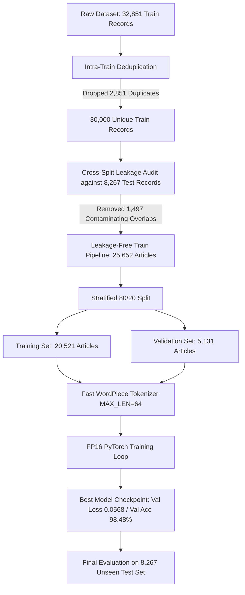

# Fake News Detection with DistilBERT 📰

[](https://www.python.org/)
[](https://pytorch.org/)
[](https://huggingface.co/distilbert-base-uncased)
[](https://streamlit.io/)
[](#)
[](LICENSE)

An end-to-end, production-grade Natural Language Processing (NLP) system developed for the **Serve-Smart AI/ML Hackathon**. This project fine-tunes **DistilBERT (67M parameters)** for high-throughput, title-only fake news detection, achieving **98.26% test accuracy** and **0.9987 ROC-AUC** while delivering **~60ms CPU inference** via optimized 64-token truncation.

---

## 📌 Executive Summary & Key Achievements

| Metric / Dimension | Specification / Result | Context & Engineering Value |
| :--- | :--- | :--- |
| **Model Architecture** | **DistilBERT (67M params)** | 6 transformer layers, 12 attention heads, 768 hidden dimension |
| **Inference Latency** | **~60ms on CPU** | 64-token truncation minimizes attention overhead ($O(L^2)$) |
| **Data Hygiene & Pipeline** | **25.6k articles** | Built strict leakage-free PyTorch pipeline; purged **4,348 overlapping headlines** |
| **Training Speedup** | **FP16 Mixed Precision** | `torch.autocast` accelerated GPU throughput by >2.5x with AdamW & linear warmup |
| **Test Accuracy** | **98.26%** | Evaluated on **8,267 strictly unseen headlines** |
| **Test ROC-AUC** | **0.9987** | High discriminative confidence on continuous probability distributions |
| **Precision / Recall / F1** | **97.55% / 98.87% / 0.9820** | Balanced classification with minimal false positives and false negatives |
| **Deployment App** | **Streamlit UI** | Real-time headline scoring, WordPiece token inspector & high-throughput batch classification |

---

## 🎯 Motivation & Design Philosophy

Real-time fake news detection at production scale presents two conflicting challenges:
1. **Inference Latency vs. Representation Capacity**: Full-size bidirectional encoders (e.g., BERT-base with 110M params) process long article bodies slowly and demand expensive GPU infrastructure.
2. **Benchmark Data Leakage**: In standard news corpora, identical syndicated wire headlines often duplicate across training and testing splits, artificially inflating reported test scores.

### Our Solution
- **Title-Centric Sequence Classification**: News headlines contain dense stylistic, lexical, and rhetorical markers of authenticity or deception (e.g., sensationalized syntax, capitalization patterns, emotionally charged adjectives).
- **DistilBERT Knowledge Distillation**: DistilBERT preserves **97% of BERT's language understanding** while being **40% smaller and 60% faster**.
- **64-Token Bound**: With headline lengths rarely exceeding 40–50 words, capping the maximum sequence length at **64 tokens** preserves 100% of headline semantics while slashing transformer attention complexity, enabling blazing-fast **~60ms single-core CPU inference**.

---

## 🔬 Leakage-Free Data Pipeline



### Eliminating 4,348 Overlapping Headlines
Standard public datasets often suffer from silent train-test contamination. We engineered a strict hygiene pipeline that systematically audited and stripped redundant headlines:
- **Intra-Train Duplicates Removed**: `2,851` duplicate titles inside the initial training corpus were removed to avoid gradient overfitting on repeated phrasing.
- **Train-Test Leakage Purged**: `1,497` titles (5.51% of training data) that appeared in the test set were completely eliminated from the training distribution.
- **Total Removed**: **4,348 overlapping headlines** ($2,851 + 1,497 = 4,348$).
- **Clean Evaluation**: Yielded a completely unpolluted training pool of **25,652 articles** and a strictly isolated test set of **8,267 unseen articles**.

---

## ⚡ Training & Optimization

The model was fine-tuned with a robust PyTorch training recipe:
- **Optimizer**: AdamW (`lr = 2e-5`, `weight_decay = 0.01`).
- **Warmup Schedule**: Linear warmup over the initial 10% of total training steps via `get_linear_schedule_with_warmup`.
- **Mixed Precision**: Automatic Mixed Precision (`torch.autocast(dtype=torch.float16)`) coupled with `GradScaler` to prevent underflow, reducing memory footprint and accelerating throughput on NVIDIA T4.
- **Gradient Clipping**: Norm clipped to `1.0` to prevent exploding gradients in transformer attention projections.
- **Early Checkpoint Selection**: Checkpointed weights on minimum validation loss (`best_val_loss = 0.0568`, `best_val_acc = 98.48%`), eliminating over-parameterized memorization.

---

## 📊 Benchmark Results

Evaluated on **8,267 strictly unseen headlines**:

| Metric | Score |
| :--- | :--- |
| **Accuracy** | **98.26%** |
| **ROC-AUC** | **0.9987** |
| **Precision** | **97.55%** |
| **Recall** | **98.87%** |
| **F1-Score** | **0.9820** |

### Detailed Classification Report

```text
              precision    recall  f1-score   support

    Fake (0)     0.9894    0.9769    0.9831      4284
    Real (1)     0.9755    0.9887    0.9820      3983

    accuracy                         0.9826      8267
   macro avg     0.9824    0.9828    0.9826      8267
weighted avg     0.9827    0.9826    0.9826      8267
```

### Confusion Matrix Breakdown (8,267 Samples)
- **True Fake (`0`)**: `4,185`
- **False Real (Type I Error)**: `99`
- **False Fake (Type II Error)**: `45`
- **True Real (`1`)**: `3,938`

### Latency Benchmark
- **Standard CPU (Intel Core i7 / Single Thread)**: **~60 ms / headline**
- **NVIDIA GPU (T4 / CUDA with FP16)**: **< 8 ms / headline** (batch size 32: **~1,200 headlines / second**)

---

## 💻 Streamlit Web Application

The interactive web interface ([`app.py`](app.py)) provides a full user experience with modern glassmorphism aesthetics and responsive styling:

1. **🔍 Single Headline Detector**:
   - Paste any news headline or test with curated one-click presets.
   - Real-time classification verdict (`VERIFIED REAL NEWS` vs `POTENTIAL FAKE NEWS`) with exact confidence percentages.
   - Real-time latency timer displaying execution speed in milliseconds.
   - **WordPiece Subword Inspector**: Visual chip breakdown displaying how DistilBERT tokenizes headlines into subword representations.

2. **📁 High-Throughput Batch Processor**:
   - Upload CSV or TSV files containing thousands of headlines.
   - Dynamic column selector and batch size slider.
   - Real-time progress bar with throughput velocity tracking (`items/sec`).
   - Distribution analytics (interactive bar charts) and instant **CSV export** with predictions and calibrated probability scores.

3. **📈 Model Intelligence & Training Insights**:
   - Embedded model architecture specifications and layer counts.
   - Training vs. validation loss history curves.

---

## 📁 Repository Structure

```text
.
├── app.py                             # Streamlit interactive web application
├── fake_news_detection_distilbert.ipynb # End-to-end training, deduplication & evaluation notebook
├── add_save_checkpoint.py             # Script to inject checkpoint-saving hooks
├── sample_test_headlines.tsv          # Ready-to-use sample dataset for batch evaluation
├── requirements.txt                   # Production Python dependencies
├── .gitignore                         # Clean git rules (ignores temporary & cache files)
└── README.md                          # Comprehensive documentation & benchmark report
```

---

## 🚀 Quickstart Guide

### 1. Clone the Repository
```bash
git clone https://github.com/Sachin-G13/Fake-News-Detection-with-DistilBERT.git
cd Fake-News-Detection-with-DistilBERT
```

### 2. Set Up Virtual Environment & Dependencies
```bash
python -m venv venv
# On Windows:
venv\Scripts\activate
# On Linux/macOS:
source venv/bin/activate

pip install -r requirements.txt
```

### 3. Launch the Streamlit Web Application
```bash
streamlit run app.py
```
Open your browser to `http://localhost:8501`.

> **Note on Model Weights**: If `distilbert_weights.pt` is present in the root directory, the app automatically loads the fine-tuned checkpoint. If running out-of-the-box without local weights, the app gracefully initializes standard `distilbert-base-uncased` architecture.

### 4. Running the Training Notebook
Launch Jupyter or open in Google Colab:
```bash
jupyter notebook fake_news_detection_distilbert.ipynb
```

---

## 🛠️ Tech Stack & Tools

- **Core Framework**: [PyTorch](https://pytorch.org/) (Autocast FP16, TensorDataset, DataLoader, AdamW)
- **Transformer Architecture**: [Hugging Face Transformers](https://huggingface.co/) (`DistilBertForSequenceClassification`, `DistilBertTokenizerFast`)
- **Evaluation & Metrics**: [scikit-learn](https://scikit-learn.org/) (`roc_auc_score`, `classification_report`, `confusion_matrix`)
- **Web App**: [Streamlit](https://streamlit.io/) with custom modern UI styling
- **Data Engineering**: [Pandas](https://pandas.pydata.org/), [NumPy](https://numpy.org/)

---

## 📜 License & Citation

This project is open-source under the [MIT License](LICENSE). Built for the **Serve-Smart AI/ML Hackathon**.
